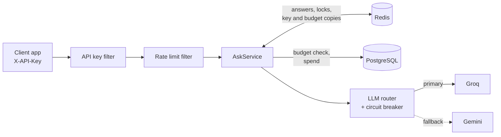

# Multi-Tenant LLM Gateway

A gateway that sits between apps and LLM providers, so each customer's AI usage stays fast, affordable and within budget, even when a provider goes down.

Built with Java 21, Spring Boot, Redis, PostgreSQL and Docker.

## Why this exists

Startups adding AI features run into the same problems:

- **Cost:** every LLM call costs money, even when 100 users ask the same question.
- **Latency:** LLM answers take seconds.
- **Limits:** providers rate limit your account, so one busy customer can block everyone else.
- **Outages:** when the provider goes down, the AI feature goes down with it.

Instead of calling the LLM directly, apps call this gateway. It reuses answers, enforces per-customer limits and budgets, and fails over to a backup provider automatically.

## Features

- **Per-customer API keys**, stored only as SHA-256 hashes, with zero-downtime rotation and instant revocation
- **Per-tenant rate limiting** in Redis, with `Retry-After` and `X-RateLimit-*` headers
- **Monthly budgets** per tenant, with spend tracked per request from real token usage
- **Redis answer cache** with TTL, scoped per tenant so one customer's data never reaches another
- **Cache stampede protection:** 20 identical concurrent requests make **1** LLM call
- **Automatic failover** from Groq to Gemini on retryable errors, with a **circuit breaker**
- **Fail open on Redis:** if the cache is down, requests still get answered
- **RFC 9457 Problem Details** for every error response
- **Metrics** for cache hits and misses, LLM latency, failovers, rate limit rejections and circuit state
- **Tests at three levels**, including Testcontainers integration tests against real Redis and PostgreSQL

## Architecture



**What happens on each request:**

1. **API key filter:** hashes the `X-API-Key` header and looks it up (Redis first, PostgreSQL on a miss). Unknown or revoked keys get `401`.
2. **Rate limit filter:** a fixed-window counter per tenant in Redis. Over the limit gets `429`.
3. **Cache check:** a hit returns the saved answer in a few milliseconds. Cache hits are free, so they are served even when a tenant is over budget.
4. **Stampede lock:** on a miss, one request takes a Redis lock and calls the LLM. Concurrent requests for the same question wait and read its answer from the cache.
5. **Budget check:** a tenant over its monthly budget gets `402`.
6. **LLM call:** through the router. If Groq fails with a retryable error, the request goes to Gemini. If Groq keeps failing, the circuit breaker skips it entirely.
7. **Record spend and cache the answer.**

## Tech stack

| Area | Tools |
|---|---|
| Language and framework | Java 21, Spring Boot 4 |
| Cache, locks, rate limits | Redis 8 (allkeys-lfu eviction) |
| Database | PostgreSQL 17, Flyway migrations, Spring Data JPA, JdbcClient |
| Resilience | Resilience4j circuit breaker |
| LLM providers | Groq (primary), Gemini (fallback), via OpenAI-compatible APIs |
| Observability | Spring Boot Actuator, Micrometer |
| Testing | JUnit 5, Mockito, MockMvc, Testcontainers |
| Packaging | Multi-stage Dockerfile, Docker Compose |

## Getting started

### Prerequisites

- [Docker Desktop](https://www.docker.com/products/docker-desktop/)
- A free [Groq API key](https://console.groq.com/keys)
- A free [Gemini API key](https://aistudio.google.com/)

You do not need Java or Maven installed. Everything builds and runs inside Docker.

### 1. Configure secrets

Copy `.env.example` to `.env` and fill in your values:

```
GROQ_API_KEY=your_groq_key
GEMINI_API_KEY=your_gemini_key
POSTGRES_PASSWORD=any_password
ADMIN_TOKEN=a_long_random_string
```

`.env` is in `.gitignore` and `.dockerignore`, so secrets are never committed or baked into the image.

### 2. Start everything

```
docker compose up -d --build
```

This starts Redis, PostgreSQL (with a health check) and the gateway. Flyway creates the tables on first start. Check it is up:

```
curl http://localhost:8080/actuator/health
```

### 3. Create a tenant

```
curl -X POST http://localhost:8080/admin/v1/tenants \
  -H "X-Admin-Token: <your ADMIN_TOKEN>" \
  -H "Content-Type: application/json" \
  -d '{"name":"acme"}'
```

The response includes the tenant's API key (`gw_live_...`). **It is shown only once.** Only its hash is stored.

### 4. Ask a question

```
curl -X POST http://localhost:8080/v1/ask \
  -H "X-API-Key: <the gw_live_ key>" \
  -H "Content-Type: application/json" \
  -d '{"question":"What is Redis in one sentence?"}'
```

Ask the same question again and `source` changes from `llm` to `cache`, with `timeTakenMs` dropping to a few milliseconds.

## API

### Tenant endpoint

| Method | Path | Description |
|---|---|---|
| `POST` | `/v1/ask` | Ask a question. Requires `X-API-Key`. |

### Admin endpoints (require `X-Admin-Token`)

| Method | Path | Description |
|---|---|---|
| `POST` | `/admin/v1/tenants` | Create a tenant and its first API key |
| `POST` | `/admin/v1/tenants/{tenantId}/api-keys` | Issue an additional key (for rotation) |
| `POST` | `/admin/v1/api-keys/{keyId}/revoke` | Revoke a key, effective immediately |
| `PUT` | `/admin/v1/tenants/{tenantId}/budget` | Set the monthly budget, for example `{"monthlyBudgetUsd": 25.00}` |

### Error responses

Every error uses [RFC 9457 Problem Details](https://www.rfc-editor.org/rfc/rfc9457):

```json
{ "title": "Too Many Requests", "status": 429,
  "detail": "Rate limit of 20 requests per minute exceeded", "instance": "/v1/ask" }
```

| Status | When |
|---|---|
| `400` | Invalid or malformed request |
| `401` | Missing, invalid or revoked API key or admin token |
| `402` | Monthly budget used up (cached answers still work) |
| `409` | Duplicate tenant name |
| `429` | Tenant rate limit exceeded |
| `502` | Both LLM providers returned an error |
| `503` | LLM providers unavailable or rate limited |

## Configuration

All settings are in `src/main/resources/application.yaml`, and any of them can be overridden with an environment variable, for example `LLM_PRIMARY_MODEL` or `GATEWAY_RATELIMIT_REQUESTSPERMINUTE`.

| Setting | Default | Purpose |
|---|---|---|
| `gateway.cache.answer-ttl` | `1h` | How long answers stay cached |
| `gateway.cache.key-version` | `v1` | Bump to invalidate every cached answer at once |
| `gateway.stampede.wait-timeout` | `15s` | How long waiting requests wait before calling the LLM themselves |
| `gateway.rate-limit.requests-per-minute` | `20` | Per-tenant rate limit |
| `gateway.auth.key-cache-ttl` | `5m` | Safety-net TTL for cached key lookups |
| `llm.primary.*` / `llm.fallback.*` | Groq / Gemini | Provider URL, model, timeouts, `max-tokens` and token prices |
| `llm.circuit-breaker.*` | 50% over 10 calls | When to stop calling the primary, and for how long |

## Testing

Run the full suite (unit, web slice and Testcontainers integration tests):

```
docker run --rm -it \
  -v /var/run/docker.sock:/var/run/docker.sock \
  -e TESTCONTAINERS_HOST_OVERRIDE=host.docker.internal \
  -v "${PWD}:/app" -v maven-repo:/root/.m2 -w /app \
  maven:3.9-eclipse-temurin-21 mvn test
```

No real API keys are needed. The LLM is mocked, and Testcontainers starts its own Redis and PostgreSQL.

| Test class | Covers |
|---|---|
| `AskServiceTest` | Cache hit and miss, fail open, budget enforcement, stampede wait and fallback |
| `LlmRouterTest` | Failover on 5xx, no failover on 400, circuit breaker opening |
| `AskControllerTest` | Validation, error formats, missing API key |
| `AskServiceIntegrationTest` | Real Redis TTL and lock release under concurrency, real spend tracking |
| `FilterIntegrationTest` | Rate limiting, revoked keys rejected even when cached, admin auth before validation |

## Experiments you can run

### Cache stampede

With the gateway running, send 20 identical requests at the same moment:

```
# Windows
set GATEWAY_API_KEY=gw_live_your_key
python scripts/stampede_test.py

# macOS / Linux
GATEWAY_API_KEY=gw_live_your_key python scripts/stampede_test.py
```

Expected last line: `AI calls made for 20 identical requests: 1`. Without the lock it was 20. The script sends exactly 20 requests, so wait a minute between runs or the rate limiter returns `429`.

### Provider outage

Point Groq at an address where nothing is listening, without changing any file:

```
docker compose stop app
docker compose run --rm -p 8080:8080 -e LLM_PRIMARY_BASEURL=http://localhost:9 app
```

Send a few new questions. Every request still gets an answer from Gemini, the log shows `State transition from CLOSED to OPEN` after 5 failures, and later requests skip Groq entirely.

### Metrics

```
http://localhost:8080/actuator/metrics/gateway.cache.requests?tag=result:hit
http://localhost:8080/actuator/metrics/gateway.llm.calls
http://localhost:8080/actuator/metrics/gateway.llm.failovers
http://localhost:8080/actuator/metrics/gateway.llm.circuit.state
http://localhost:8080/actuator/metrics/gateway.ratelimit.rejected
http://localhost:8080/actuator/metrics/gateway.stampede.waits
```

## Key design decisions

- **Cache-aside for answers, write-through for budgets and spend.** Answers are many and read unevenly, so they fill lazily. Budgets are checked on every request and must be fresh right after an admin changes them, so every write updates PostgreSQL and Redis together.
- **Invalidate after commit.** Revoking a key deletes its cached copy only after the database transaction commits, so a concurrent read cannot put the stale value back. The TTL is a safety net if the delete fails.
- **Fail open for the cache, never for security.** If Redis is down, answers come from the LLM and key lookups fall back to PostgreSQL. Authentication is never skipped.
- **Fail over only on "their problem."** Timeouts, `429` and `5xx` go to the backup. `400` and `401` do not, so bugs are not hidden. Only those retryable errors count toward the circuit breaker.
- **Per-tenant cache keys.** Lower hit rate, but one tenant's prompt or answer can never be served to another.
- **Money in integer micro-dollars,** updated with an atomic PostgreSQL upsert, rounded up so the gateway never undercharges.
- **Authentication in servlet filters,** so it runs before validation and before any controller.

## Roadmap

- [ ] Deploy to AWS: ECR, EC2, Kubernetes (k3s), RDS
- [ ] Request logs in DynamoDB
- [ ] CI/CD with GitHub Actions
- [ ] Flag answers cut off by `max_tokens`
- [ ] Semantic cache for questions with the same meaning but different wording

## Author

**Parul Jindal** · [Portfolio](https://parul671992.github.io/) · [LinkedIn](https://www.linkedin.com/in/jindal-parul/) · [GitHub](https://github.com/Parul671992)
